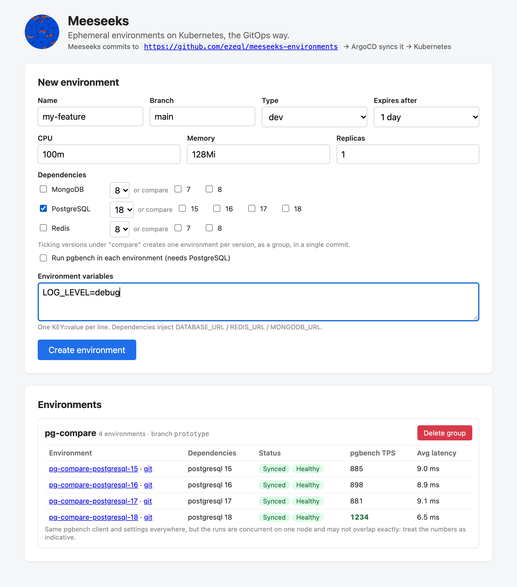

# Meeseeks

Self-service, ephemeral environments on Kubernetes, done the GitOps way.
A developer asks for an environment (branch, sizing, dependencies, env vars) through a small
Go API or web UI. Meeseeks doesn't touch the cluster: it **commits the desired state to a Git
repo**, and ArgoCD reconciles it. Every create and delete is a commit you can review, audit or revert.

```
UI / API ──commit──► client repo (environments/<name>.json) ◄──watch── ArgoCD root app ──► Application per env ──► Kubernetes
    ▲                                                                                                   │
    └──────────────────────────────── sync / health status (ArgoCD API) ──────────────────────────────┘
```



## How it works

- **Client repo** (configurable, e.g. a private `meeseeks-environments`): one ArgoCD `Application`
  per file under `environments/`. Meeseeks writes these files through the GitHub API.
- **Root app** (`meeseeks-environments`, app-of-apps): syncs `environments/*.json` into ArgoCD.
  Meeseeks creates it and registers the repo's credentials on startup (idempotent).
- **Base manifests** live in this repo under [`deploy/`](deploy): `base/` is the app (an echo server
  that prints its pod name), `deps/` has PostgreSQL, Redis and MongoDB.
- **Delete** = a commit that removes the file. The root app prunes the `Application`, and its
  `resources-finalizer` makes ArgoCD delete the workloads too.

What a request turns into, inside each committed `Application`:

| Request field | Generated |
|---|---|
| `branch` | `targetRevision` of every source (any branch of the base manifests) |
| `cpu`, `memory` | Strategic-merge patch on Deployment `app` (requests = limits) |
| `replicas` | `kustomize.replicas` |
| `env_vars` | Env vars in the same patch |
| `dependencies` | One extra source per dependency, plus `DATABASE_URL` / `REDIS_URL` / `MONGODB_URL` injected into the app |
| `env_type` | `env-type` label (`dev`, `staging`, `prod`) |
| `versions` | Kustomize image override per dependency (PostgreSQL 15–18, Redis 7–8, MongoDB 7–8) |
| `matrix` | One environment per combination, as a group under `environments/<group>/`, in **one commit** |
| `benchmark` | A pgbench Job per environment; results read from its logs through Argo CD and shown side by side per group |

Example: compare PostgreSQL versions on the same branch (shown in the screenshot):

```bash
curl -X POST localhost:22282/environments -H 'Content-Type: application/json' -d '{
  "name": "pg-compare", "branch": "main", "benchmark": true,
  "matrix": {"postgresql": ["15", "16", "17", "18"]}
}'
```

### Design notes

- **Status is asynchronous.** A bad branch still commits fine. ArgoCD then reports the error
  on the `Application`, and the UI shows it on that environment's row.
- **Git drops empty directories.** `environments/README.md` keeps the directory alive. Without it,
  deleting the last environment breaks the root app.
- **The root app sets `allowEmpty: true`.** Otherwise ArgoCD refuses an auto-sync that would
  leave zero resources ("auto-sync will wipe out all resources"), and the last environment is never pruned.
- **Names are checked against existing ArgoCD apps** before committing. Otherwise the root app
  would adopt an unrelated app, and a later delete would cascade into it.
- After each commit Meeseeks asks ArgoCD to refresh the root app, so changes land in seconds
  instead of on the ~3 min poll. In production a GitHub webhook to ArgoCD does this.

## Run it locally

Requirements: Docker, Go 1.24+, `kubectl`, and a GitHub token that can write to your client repo.

```bash
gh repo create <you>/meeseeks-environments --private --add-readme   # your client repo (needs one commit)
make up                                                               # kind cluster + Argo CD v3.6.1 on :30080
make run GITOPS_REPO=https://github.com/<you>/meeseeks-environments   # http://localhost:22282
make down                                                             # delete the cluster
```

`make up` runs [kind](https://kind.sigs.k8s.io) through `go run`, so there is nothing else to install. It keeps
its kubeconfig and the Argo CD API token in `.kind/` and leaves your current `kubectl` context alone
(`kubectl --kubeconfig .kind/kubeconfig ...` to look inside). While `.kind/` exists, `make run` uses that cluster.

**Existing cluster instead** (e.g. OrbStack): `terraform/` installs Argo CD v3.6.1 (Helm chart 10.18.0) on the
current context and writes `terraform/argocd-token.txt`, which `make run` picks up when there is no `.kind/`:

```bash
cd terraform && tofu init && tofu apply         # needs OpenTofu or Terraform and the argocd CLI
```

Configuration (environment variables; the Makefile has local defaults):

| Variable | Default in `make run` | Purpose |
|---|---|---|
| `GITOPS_REPO` | `https://github.com/ezeql/meeseeks-environments` | Client repo Meeseeks commits to |
| `GITOPS_BRANCH` | `main` | Branch of the client repo |
| `GITHUB_TOKEN` | `gh auth token` | Write access to the client repo; also registered in ArgoCD to read it |
| `ARGOCD_URL` / `ARGOCD_TOKEN` | `.kind/env`, else `http://localhost:30080` / `terraform/argocd-token.txt` | ArgoCD API |

Without a cluster, `make dev-mock` serves the UI with fake data.

With OrbStack, each environment is reachable from the Mac at `http://app.env-<name>.svc.cluster.local`.
On kind and other clusters use `kubectl port-forward -n env-<name> svc/app 8080:80`.

## API

```bash
curl -X POST localhost:22282/environments -H 'Content-Type: application/json' -d '{
  "name": "my-feature", "branch": "main", "env_type": "dev",
  "cpu": "100m", "memory": "128Mi", "replicas": 2,
  "dependencies": ["postgresql", "redis"],
  "env_vars": {"LOG_LEVEL": "debug"}
}'                                              # 202 + commit URL
curl localhost:22282/environments               # list with sync/health status
curl -X DELETE localhost:22282/environments/my-feature   # 202 + commit URL
```

## Development

```bash
make test        # unit tests (GitHub and ArgoCD faked with httptest)
make docker      # build the image
make docker-run  # run it against the local ArgoCD
```

## Known limits

- The Git writer only supports GitHub (Git Data API).
- Env var values are committed in plain text. Real secrets belong in Sealed Secrets or External Secrets.
- ArgoCD leaves the `env-<name>` namespace behind after a delete.
- `env_type` is only a label; it doesn't change sizing.
- Benchmark numbers are indicative. Every run in a group is concurrent on the same node, and the
  runs start when each Postgres is ready, so they don't overlap exactly. In one run on this setup
  PG 18 started 8 s after the others and ran alone for its last 8 s. A fair comparison needs
  dedicated nodes or runs one after another.
- Dependencies use throwaway credentials and no persistent volumes. These environments are ephemeral.
